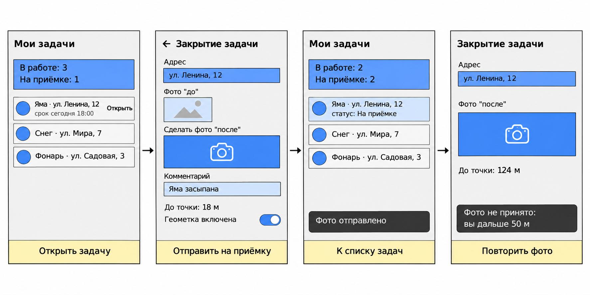
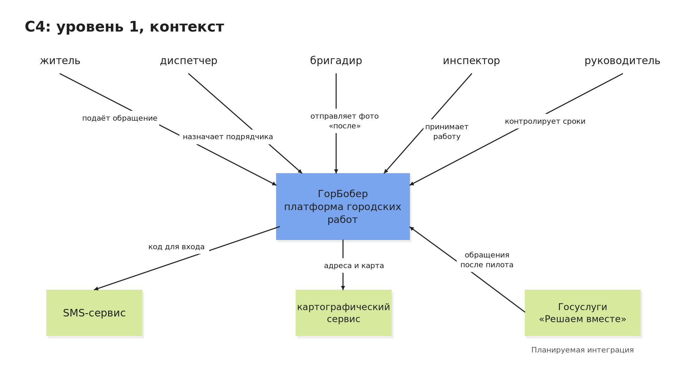
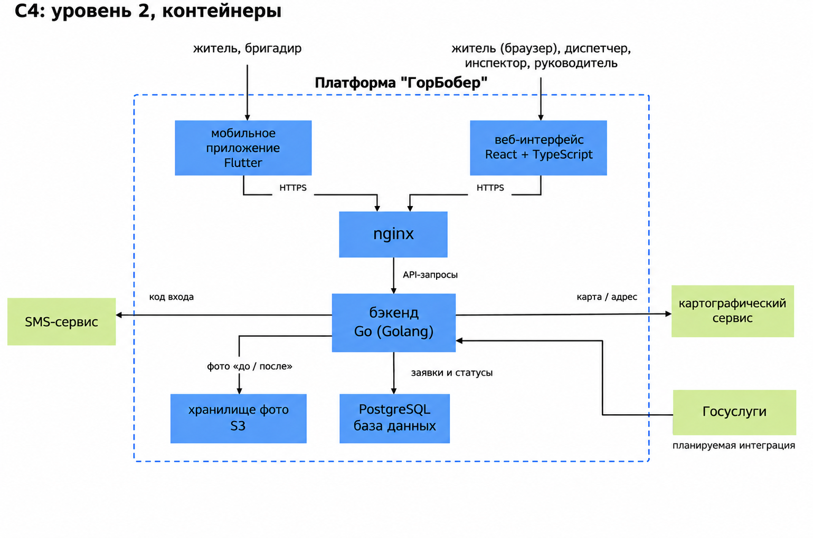

# ГорБобер

Городские работы

---

## Elevator Pitch

Жители сообщают о ямах и мусоре через Госуслуги, но после того как обращение попадает в администрацию, его выполнение теряется в звонках и таблицах: подрядчики срывают сроки и отчитываются на бумаге, а яма остаётся на месте. **"ГорБобер"** - платформа для администраций городов, которая автоматически распределяет обращения по подрядчикам согласно контрактам и следит за сроками. В отличие от обычного документооборота, мы принимаем работу только по фото "после", проверенному по геометке и времени съёмки, - отчитаться старым снимком невозможно. В результате город получает реально выполненные работы и основание для штрафов, а жители видят результат своими глазами. Мы ищем город для пилота в одном районе - хотите посмотреть MVP?

---

## Lean Canvas

### 1. Сегменты потребителей

**Покупатель (платит):**
- Администрации городов и районов - отделы благоустройства, ЖКХ и дорог.
- Власти региона и центры управления регионом (ЦУР), которые отвечают за работу с жалобами жителей.

**Пользователи (работают в системе):**
- Жители - сообщают о проблеме и видят результат.
- Диспетчеры администрации - проверяют заявки и распределяют их по подрядчикам.
- Бригады подрядчиков - получают задачи и подтверждают выполнение фото.
- Руководители (глава города, замы, начальники отделов) - смотрят статистику и принимают решения.

**Ранние последователи:**
- Города на 100-500 тыс. жителей, где много жалоб на ямы, мусор и освещение.
- Города, которые находятся внизу регионального рейтинга по работе с жалобами.
- Города с новым руководством, которому нужен быстрый и заметный результат.

### 2. Проблема

1. После того как заявку передали подрядчику, администрация теряет над ней контроль. Статус и сроки отслеживают вручную - через звонки, почту и Excel, поэтому сроки срываются незаметно.
2. Нельзя проверить, что работа действительно сделана. Подрядчики отчитываются актами и фотографиями, но снимок может быть старым или с другой улицы.
3. На одну яму приходят десятки одинаковых жалоб. Диспетчеры вручную разбирают их и распределяют, а что важнее, решают "на глаз".

**Существующие альтернативы:**
- Госуслуги "Решаем вместе" - хорошо принимают жалобы, но не следят за работой подрядчиков.
- Региональные порталы для жалоб.
- Системы электронного документооборота (СЭД).
- Excel, почта, телефон и выезды проверяющих на место.

### 3. Уникальная ценность

Администрация платит за результат, а не за отчёт: каждая городская работа принимается только по проверенному фото "после".

### 4. Решение

1. Автоматическое распределение и контроль сроков. Заявка по адресу и типу проблемы сама попадает к нужному подрядчику по контракту. Система следит за сроком, а при угрозе просрочки - эскалация руководителю.
2. Фотоприёмка с антифродом. Приложение бригады принимает только фото, снятое камерой на месте. Система проверяет геометку, время съёмки и то, что фото отличается от фото "до".
3. Объединение одинаковых жалоб и статистика. Жалобы на одну проблему собираются в одну заявку, а руководство видит просрочки, рейтинг подрядчиков, проблемные районы и штрафы по контракту.

Мы не конкурируем с Госуслугами, а продолжаем их работу: подключаемся к ним и берём жалобу в работу после того, как она принята.

### 5. Каналы

- Госзакупки и тендеры.
- Бесплатные пилоты на одном районе города, по итогам которых можно показать результат другим городам.
- Министерства цифрового развития регионов и ЦУР - через них можно выйти сразу на несколько городов.
- Компании-интеграторы, которые уже работают с регионами.
- Конференции и форумы про цифровизацию городов.
- Для жителей: кнопка на сайте города, подключение к Госуслугам, QR-коды на улицах.

### 6. Потоки прибыли

- Годовая подписка для города - цена зависит от количества жителей.
- Разовая оплата за внедрение: настройка контрактов, зон ответственности и подключение к системам, которые уже есть у города.
- Обучение сотрудников и техподдержка - оплата раз в год.
- Дополнительные модули: распознавание проблемы по фото, расширенная статистика, модуль для управляющих компаний ЖКХ.
- Региональная лицензия - сразу для всех городов региона.

### 7. Структура издержек

**Постоянные:**
- Зарплаты команды: backend, mobile, frontend, ML, QA, аналитика, продажи.
- Серверы, хранение данных и защита персональных данных жителей.
- Выполнение требований безопасности для работы с государством.

**Переменные:**
- Участие в тендерах: подготовка документов, юристы.
- Бесплатные пилоты (команда внедрения, выезды).
- Внедрение и поддержка в каждом новом городе.
- Хранение фотографий - растёт вместе с количеством заявок.

### 8. Ключевые метрики

**Польза для города:**
- Среднее время от жалобы до статуса "Исполнено".
- Доля заявок, закрытых в срок.
- Доля работ, которые не прошли фотоприёмку.
- Доля повторных жалоб на ту же проблему.
- Оценка результата жителями.

**Бизнес:**
- Количество подключённых городов.
- Конверсия пилот -> контракт.
- Годовая выручка по контрактам.
- Доля продлённых контрактов.
- Стоимость привлечения одного города: тендеры и пилоты.

### 9. Скрытое преимущество

- Накопленная база фото "до/после" и данных о подрядчиках. Со временем из неё получается рейтинг надёжности подрядчиков по городу и региону, который нельзя купить или быстро повторить.
- Успешные кейсы. Результаты в одних городах - главный аргумент для других, а новичку без опыта внедрений выиграть тендер сложно.
- Готовые подключения и выполненные требования (защита персональных данных, подключение к Госуслугам). Конкурентам на это нужно много времени и денег.

**Конкуренты:**
- Госуслуги "Решаем вместе".
- Региональные порталы для жалоб.
- Системы электронного документооборота.
- Компании, которые делают такие системы на заказ.

---

## Гипотезы

Самый критичный риск для ГорБобра - риск ценности: готовы ли администрации городов вообще менять привычный процесс и платить за контроль подрядчиков. Если это никому не нужно, всё остальное не имеет смысла.

### Гипотеза 1 (главная)

**H (Гипотеза):** Мы верим, что сотрудники администраций, которые отвечают за благоустройство, не могут нормально проверить работу подрядчиков и готовы бесплатно попробовать фотоприёмку работ на одном районе.

**A (Действие):** Без разработки. Проводим 10 проблемных интервью с сотрудниками управлений благоустройства, ЖКХ и ЦУР из разных городов (пишем на официальные почты, звоним, ищем через знакомых). Спрашиваем, как сейчас они проверяют выполнение работ, сколько времени на это уходит и сколько заявок закрывается с опозданием. В конце интервью предлагаем бесплатный пилот на одном районе в формате консьерж-MVP: бригады отправляют фото "после" в Telegram-чат, а мы сами вручную проверяем место и время съёмки и ведём заявки в Google Таблице.

**D (Данные):**
- Сколько человек из 10 подтвердили проблему (срывы сроков, нет возможности проверить фото).
- Сколько городов согласились на бесплатный пилот.

**I (Выводы):**
- Если минимум 6 из 10 подтверждают проблему и хотя бы 2 города соглашаются на пилот - гипотеза подтверждена, идём дальше.
- Если проблему подтверждают меньше 4 человек - проблема выдуманная, делаем Pivot (см. План Б).

### Гипотеза 2

**H (Гипотеза):** Мы верим, что бригады подрядчиков будут отправлять фото выполненной работы через приложение, если без фото работа не принимается и не оплачивается.

Это риск юзабилити и жизнеспособности: если бригады откажутся фотографировать или будут обходить систему, фотоприёмка не заработает. Проверять её будем во время пилота из Гипотезы 1: смотрим, какая доля закрытых заявок пришла с фото, сделанным на месте.

---

## Юнит-экономика

Юнит - 1 контракт с городом (как в B2B: 1 клиент = 1 контракт).

Все цифры - предварительная оценка, будут уточняться после интервью и пилотов.

### CAC - откуда придут клиенты и сколько это стоит

Клиенты приходят через прямые продажи: письма и звонки в администрации, конференции по цифровизации городов, бесплатные пилоты и тендеры.

Воронка на 6 месяцев:
- Выходим на 100 городов через письма, звонки и конференции. Затраты: зарплата менеджера по продажам 100 000 ₽ × 6 мес. + 2 конференции по 100 000 ₽ = 800 000 ₽.
- Конверсия во встречу и демонстрацию: 20% -> 20 городов.
- Конверсия в бесплатный пилот на 3 месяца: 25% -> 5 городов. Затраты: 150 000 ₽ на один пилот = 750 000 ₽.
- Все 5 городов участвуют в тендере. Затраты: 50 000 ₽ на подготовку документов = 250 000 ₽.
- Конверсия в выигранный контракт: 60% -> 3 города.

Всего потрачено: 800 000 + 750 000 + 250 000 = 1 800 000 ₽

**CAC** = 1 800 000 ₽ / 3 контракта = **600 000 ₽** за один город.

### LTV - на чём зарабатываем

Зарабатываем на годовой подписке для города.

- Подписка для города около 300 тыс. жителей: 1 500 000 ₽ в год.
- Расходы на одного клиента (серверы, хранение фото, поддержка): около 30%, то есть 450 000 ₽ в год.
- Прибыль с одного города: 1 500 000 - 450 000 = 1 050 000 ₽ в год.
- Средний срок работы с городом: 2 года (контракты по тендеру обычно на 1-2 года, продление не гарантировано).

**LTV** = 1 050 000 ₽ × 2 года = **2 100 000 ₽**

### Сходимость экономики

LTV / CAC = 2 100 000 / 600 000 = **3,5**

Это больше 3, значит экономика сходится: каждый город окупает своё привлечение и приносит деньги на развитие продукта.

Срок окупаемости: один город приносит 1 050 000 / 12 = 87 500 ₽ прибыли в месяц, значит CAC окупается за 600 000 / 87 500 = примерно 7 месяцев. А город остаётся с нами в среднем 24 месяца.

Самое слабое место - длинные продажи. Если пилоты будут дорожать или города будут реже продлевать контракт, LTV / CAC быстро упадёт ниже 3.

---

## План Б (Pivot)

На бумаге экономика сходится, но в B2G есть большой риск: тендеры долгие, а продления контрактов не гарантированы. Поэтому резервный план - Customer Segment Pivot (тот же продукт для другой аудитории).

**Что меняем:** вместо администраций городов продаём ГорБобер управляющим компаниям ЖКХ. У них та же проблема: жители жалуются на мусор, сломанные лампочки и лужи во дворах, а УК не может проверить, сделали ли работу дворники и подрядчики.

**Почему это может сработать:**
- Продукт почти не меняется: та же заявка, то же фото "до" и "после", та же проверка места и времени съёмки.
- Не нужны тендеры - УК может купить подписку сразу, продажи становятся быстрее и дешевле, CAC падает.
- Управляющих компаний в каждом городе десятки, клиентов больше, чем администраций.

**Что меняется в Lean Canvas:** "Сегменты потребителей" (вместо администраций - управляющие компании), "Каналы" (прямые продажи и реклама вместо тендеров) и "Потоки прибыли" (ежемесячная подписка с меньшим чеком вместо годовой лицензии).

---

## User Stories

### Роли

- Житель - сообщает о проблеме в городе и следит за результатом.
- Диспетчер администрации - принимает заявки и распределяет их по подрядчикам.
- Бригадир подрядчика - выполняет работу и подтверждает её фото.
- Инспектор администрации - проверяет и принимает выполненную работу.
- Руководитель (начальник отдела благоустройства) - следит за сроками и работой подрядчиков.

### Истории

1. Как житель, я хочу отправить фото проблемы с геометкой, чтобы её исправили.
2. Как житель, я хочу видеть статус своей заявки, чтобы знать, что с ней происходит.
3. Как житель, я хочу увидеть фото "после", когда заявка выполнена, чтобы убедиться, что проблему действительно решили.
4. Как житель, я хочу видеть на карте жалобы, которые уже отправили рядом, чтобы не отправлять повторную, а поддержать существующую.
5. Как житель, я хочу оценить результат работы, чтобы администрация знала, доволен ли я.
6. Как диспетчер, я хочу видеть все новые заявки в одном списке, чтобы не собирать их из почты и звонков.
7. Как диспетчер, я хочу назначить заявку подрядчику и указать срок, чтобы работа началась.
8. Как диспетчер, я хочу видеть сроки по всем заявкам и список просроченных, чтобы контролировать подрядчиков.
9. Как диспетчер, я хочу, чтобы заявка сама назначалась нужному подрядчику по адресу и типу проблемы, чтобы не распределять вручную.
10. Как диспетчер, я хочу, чтобы одинаковые жалобы объединялись в одну заявку, чтобы не разбирать дубли вручную.
11. Как бригадир, я хочу получать задачи в приложении с адресом, точкой на карте и фото "до", чтобы быстро найти место.
12. Как бригадир, я хочу закрыть задачу, сделав фото "после" в приложении, чтобы подтвердить выполнение и получить оплату.
13. Как инспектор, я хочу, чтобы система сама проверяла геометку и время съёмки фото "после", чтобы подрядчик не мог отчитаться старым снимком.
14. Как инспектор, я хочу принять работу или вернуть её на доработку в один клик, чтобы быстро закрывать заявки.
15. Как руководитель, я хочу получать уведомление, когда заявка близка к просрочке, чтобы успеть вмешаться.
16. Как руководитель, я хочу видеть статистику по районам и рейтинг подрядчиков, чтобы понимать, кто срывает сроки.
17. Как житель, я хочу, чтобы тип проблемы определялся по фото автоматически, чтобы не выбирать его самому.

### Приоритизация (MoSCoW)

**Must have** (без этого продукт не работает): 1, 2, 3, 6, 7, 8, 11, 12, 13, 14

**Should have** (важно, но можно запуститься и без этого): 4, 9, 10, 15, 16

**Could have** (приятно, если успеем): 5

**Won't have**: 17 - распознавание фото дорогое и долгое.

### MVP и MLP

**MVP** - все истории Must have: 1, 2, 3, 6, 7, 8, 11, 12, 13, 14.

Этого достаточно, чтобы пройти весь путь заявки: житель отправил фото -> диспетчер назначил подрядчика и срок -> бригада сделала работу и фото "после" -> система проверила фото -> инспектор принял работу -> житель увидел результат. Именно такой путь мы проверяем на пилоте.

**MLP** - истории Should и Could have: 4, 5, 9, 10, 15, 16.

Автоматическое распределение, объединение дублей, эскалация, статистика и рейтинг подрядчиков и оценка жителей. Без них продукт работает, но с ними администрация экономит время, а работать с ГорБобром становится удобно и приятно.

---

## Требования к главным историям

### История 1. Житель отправляет фото проблемы

Как житель, я хочу отправить фото проблемы с геометкой, чтобы её исправили.

**Функциональные требования (ФТ):**
- Я могу сфотографировать проблему камерой или выбрать фото из галереи (от 1 до 3 фото).
- Я могу не вводить адрес вручную: место определяется по геометке автоматически, а точку на карте можно поправить.
- Я могу выбрать тип проблемы: яма, мусор, освещение, снег, другое.
- Я могу добавить комментарий до 500 символов.
- Я могу войти по номеру телефона с кодом из SMS, без пароля.
- Я могу после отправки увидеть номер заявки и найти её в разделе "Мои заявки" со статусом "Новая".

**Нефункциональные требования (НФТ):**
- Заявка отправляется не дольше чем за 3 секунды при обычном мобильном интернете.
- Фото сжимается на телефоне до 2 МБ перед отправкой.
- Работает в приложении на iOS и Android, а также в мобильном браузере (кнопка на сайте города).
- Интерфейс понятен пожилым людям: крупные кнопки, контрастный текст, отправка заявки не больше чем в 3 шага.
- Если нет интернета, заявка сохраняется на телефоне и отправляется сама, когда появится связь.
- Система выдерживает до 1000 заявок в час (пик весной, когда сходит снег и открываются ямы).
- Номера телефонов жителей хранятся на серверах в России по закону о персональных данных.

### История 12. Бригадир закрывает задачу фото "после"

Как бригадир, я хочу закрыть задачу, сделав фото "после" в приложении, чтобы подтвердить выполнение и получить оплату.

**Функциональные требования (ФТ):**
- Я могу открыть задачу и увидеть адрес, точку на карте, фото "до" и срок выполнения.
- Я могу сделать фото "после" только камерой внутри приложения - загрузить фото из галереи нельзя.
- Я могу отправить от 1 до 3 фото "после".
- Я могу отправить фото, только если оно сделано не дальше 50 метров от места заявки. Если дальше, фото не принимается и я вижу причину.
- Я могу отправить фото, только если оно сделано после создания заявки.
- Я могу увидеть, что после проверки задача перешла в статус "На приёмке" и ушла инспектору.
- Я могу увидеть причину, если инспектор вернул работу на доработку, и задача снова появляется в моём списке.

**Нефункциональные требования (НФТ):**
- Проверка геометки и времени съёмки занимает не больше 10 секунд.
- Приложение работает на iOS и Android, в том числе на недорогих Android-телефонах.
- Если на месте нет интернета, фото сохраняется в приложении вместе с геометкой и временем съёмки и отправляется, когда появится связь. Время берётся из момента съёмки, а не отправки.
- Приложение не принимает фото, если на телефоне включена подмена местоположения.
- Фото "до" и "после" хранятся не меньше 3 лет - на случай проверок и споров по контракту.
- Каждое действие бригады записывается в журнал (кто, когда и что отправил), чтобы в споре с подрядчиком можно было всё проверить.


---

## Доменные зоны (DDD)

Приложение разделено на 5 доменных зон.

### 1. Приём обращений жителей

Житель сообщает о городской проблеме, прикладывает фотографии, геометку и комментарий.

- Resident — житель, который сообщает о проблеме
- Report — обращение жителя
- Before_photo — фото проблемы до выполнения работы
- Location — геометка места проблемы

### 2. Управление заявками

Диспетчер принимает обращения, создаёт рабочие заявки, назначает подрядчика и срок выполнения.

- Request — заявка на выполнение городской работы
- Dispatcher — сотрудник администрации, который распределяет заявки
- Status — статус заявки: "Новая", "В работе", "На приёмке", "Исполнено", "На доработке"
- Deadline — срок выполнения заявки

### 3. Исполнение работ подрядчиком

Бригадир получает назначенные задачи, выполняет работы и отправляет фото "после".

- Contractor — подрядчик, который выполняет городские работы
- Foreman — бригадир подрядчика
- Task — задача, назначенная подрядчику
- After_photo — фотография выполненной работы

### 4. Проверка и приёмка результата

Система автоматически проверяет фото "после" по геометке, времени съёмки и признакам подмены GPS. Инспектор принимает работу или возвращает на доработку.

- Inspector — сотрудник администрации, который принимает работу
- Photo_verification — автоматическая проверка фотографии
- Geolocation_check — проверка расстояния до места заявки, не больше 50 метров
- Capture_time_check — проверка, что фото сделано после создания заявки
- GPS_spoofing_check — проверка признаков подмены местоположения
- Acceptance — окончательное решение инспектора о приёмке работы

### 5. Контроль и аналитика

Руководитель контролирует сроки и просрочки. В расширенной версии видит статистику по районам и рейтинг подрядчиков.

- Manager — руководитель, который контролирует исполнение
- Overdue — заявка, у которой нарушен срок выполнения
- Contractor_rating — оценка подрядчиков по срокам и качеству
- Statistics — сводные данные по работе системы

---

## BDD

Критический путь MVP: **бригадир закрывает задачу фото "после", система проверяет снимок и передаёт задачу инспектору на приёмку**.

Автоматическая проверка включает три условия:
- **Геометка:** фото сделано не дальше 50 метров от места заявки.
- **Время съёмки:** фото сделано после создания заявки.
- **Подмена GPS:** система не обнаруживает признаков подмены местоположения.

Эти проверки подтверждают допустимость снимка, но не качество ремонта. Окончательное решение о приёмке принимает инспектор.

#### Сценарий успеха
**Дано:**
- бригадир открыл задачу в статусе "В работе";
- у задачи есть адрес, фото "до" и срок выполнения;
- бригадир находится рядом с местом заявки.

**Когда:**
- бригадир делает фото "после" через приложение;
- система получает фото, геометку и время съёмки.

**Тогда:**
- система проверяет расстояние до места заявки (не более 50 метров) и время съёмки (после создания заявки);
- признаков подмены GPS не обнаружено, поэтому снимок проходит автоматическую проверку;
- задача переводится в статус "На приёмке" и передаётся инспектору;
- бригадир видит сообщение **"Фото отправлено"**.

#### Сценарий отказа
**Дано:**
- бригадир открыл задачу в статусе "В работе";
- у задачи есть адрес и фото "до";

**Когда:**
- бригадир отправляет фото "после";
- система определяет, что фото сделано дальше 50 метров от точки заявки.

**Тогда:**
- фотография не принимается, даже если время съёмки корректно и подмена GPS не обнаружена;
- статус задачи остаётся "В работе";
- бригадир видит сообщение **"Фото не принято: вы дальше 50 м"** и кнопку **"Повторить фото"**.

---

## Wireframes



На экранах показан критический путь **"закрытие задачи фото "после""**. При отправке система проверяет геометку, время съёмки и признаки подмены GPS.

**Успех:** экран списка задач, затем экран закрытия задачи, затем экран со статусом **"На приёмке"** и снекбаром **"Фото отправлено"**.

**Отказ:** экран закрытия задачи, затем сообщение **"Фото не принято: вы дальше 50 м"** и кнопка **"Повторить фото"**.

---

## API-First

Для MVP спроектированы две основные API-ручки: создание заявки жителем и отправка фото "после" бригадиром. Формат приведён как схема JSON: String — строка, Float — число, DateTime — дата и время, Boolean — логическое значение.

#### Создать заявку

```text
POST /api/v1/requests
{
  "category": String,
  "location": {
    "latitude": Float,
    "longitude": Float
  },
  "comment": String,
  "photos": [
    { "photo_id": String }
  ]
}

201 {
  "id": String,
  "number": String,
  "status": "Новая",
  "message": "Заявка создана"
}

400 {
  "message": "Укажите тип проблемы, место и фото"
}
```

#### Отправить фото "после"

```text
POST /api/v1/tasks/{task_id}/completion
{
  "photos": [
    {
      "photo_id": String,
      "capture_source": "IN_APP_CAMERA",
      "captured_at": DateTime,
      "location": {
        "latitude": Float,
        "longitude": Float
      }
    }
  ]
}

200 {
  "status": "На приёмке",
  "verification": {
    "distance_m": Float,
    "captured_after_request": Boolean,
    "gps_spoofing_detected": Boolean
  },
  "message": "Фото отправлено"
}

422 {
  "status": "В работе",
  "message": "Фото не принято: вы дальше 50 м"
}
```

---

## C4: уровень 1, контекст



Синий блок — платформа "ГорБобер", которую разрабатываем сами. Зелёные блоки — внешние системы; подпись «Планируемая интеграция» у Госуслуг показывает, что их подключение будет после пилота. На этом уровне не указываем серверы и технологии.

**Кто работает с платформой:**

- Житель создаёт обращение с фото и геометкой, затем следит за статусом и смотрит результат.
- Диспетчер администрации принимает заявки, назначает подрядчика и срок выполнения.
- Бригадир получает задачи, выполняет работу и отправляет фото "после".
- Инспектор проверяет результат и принимает работу либо возвращает её на доработку.
- Руководитель контролирует сроки, просрочки и ход исполнения.

**Внешние системы:**

- SMS-сервис отправляет жителю одноразовый код для входа по номеру телефона.
- Картографический сервис помогает показать точку заявки на карте и определить адрес по координатам.
- Госуслуги "Решаем вместе" — планируемый источник обращений после пилота. В MVP диспетчер может принять обращение вручную, поэтому работа платформы от этой интеграции не зависит.

---

## C4: уровень 2, контейнеры



Внутри платформы шесть основных частей:

- **Мобильное приложение (Flutter)** — одно приложение для iOS и Android: житель подаёт обращение, бригадир получает задачи и делает фото "после" через камеру. При потере связи данные и исходные метки съёмки сохраняются локально до отправки.
- **Адаптивный веб-интерфейс (React + TypeScript)** — подача обращений из мобильного браузера, а также рабочие экраны диспетчера, инспектора и руководителя. Для черновиков жителя предусмотрено локальное сохранение в браузере.
- **Nginx** — принимает HTTPS-запросы, раздаёт веб-интерфейс и передаёт запросы API на сервер.
- **Бэкенд (Go / Golang, REST API)** — проверяет права ролей, создаёт и назначает заявки, контролирует сроки, проверяет метаданные фотографий и передаёт результаты инспектору. REST API реализуем через стандартный net/http.
- **PostgreSQL** — хранит пользователей, заявки, задачи, статусы, сроки, координаты и журнал действий.
- **S3-совместимое хранилище** — хранит фотографии "до" и "после" не менее трёх лет; в PostgreSQL остаются ссылки и метаданные файлов.

**Как проходит ключевой сценарий:** бригадир делает фото "после" в приложении -> через Nginx отправляет данные на бэкенд -> сервер проверяет расстояние до заявки, время съёмки и признаки подмены местоположения -> сохраняет фото и переводит задачу в статус "На приёмке" -> инспектор отдельно принимает работу или возвращает на доработку. Сервер не считает автоматическую проверку доказательством качества ремонта.

В пилотной версии подрядчика назначает диспетчер. Автоматическое распределение и интеграцию с Госуслугами добавим после проверки MVP. Отдельные микросервисы, Redis и брокер сообщений для заданной начальной нагрузки не нужны.

---

## Стек технологий MVP

| Часть | Технология | Почему выбрана |
| --- | --- | --- |
| Мобильное приложение | Flutter (Dart) | Один код для iOS и Android; есть работа с камерой, геолокацией и локальным хранением фото при отсутствии сети. |
| Мобильный сайт и кабинет администрации | React + TypeScript, PWA | Один адаптивный интерфейс для браузера жителя и сотрудников; можно сохранять черновики обращений локально. |
| Точка входа | Nginx | HTTPS, выдача статических файлов и передача API-запросов на сервер. |
| Бэкенд | Go (Golang) | Эффективно обрабатывает параллельные HTTP-запросы и подходит для постепенного роста числа городов. |
| База данных | PostgreSQL | Связанные сущности: жители, заявки, подрядчики, сроки и история проверок, надёжные транзакции. |
| Хранение фотографий | S3-совместимое объектное хранилище | Фото не занимают место в базе данных, удобно обеспечить длительное хранение и доступ по правам. |
| Вход жителя | Внешний SMS-сервис | Отправляет одноразовый код входа без пароля, как требуется в User Stories. |
| Карта и адрес | Картографический API | Отображение точек заявок и определение адресов. |

**Почему такой стек для MVP:** сначала запускаем одно серверное приложение на Go, одну базу и отдельное хранилище фотографий. При подключении новых городов можно добавлять серверные экземпляры за Nginx и масштабировать базу и хранилище по фактической нагрузке, не переходя сразу к микросервисам.
